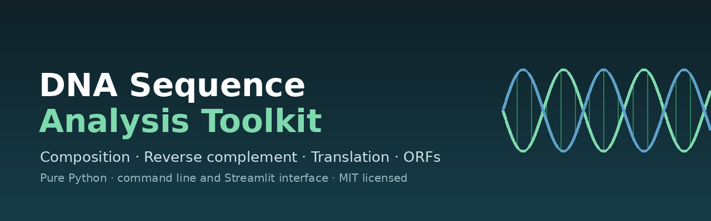
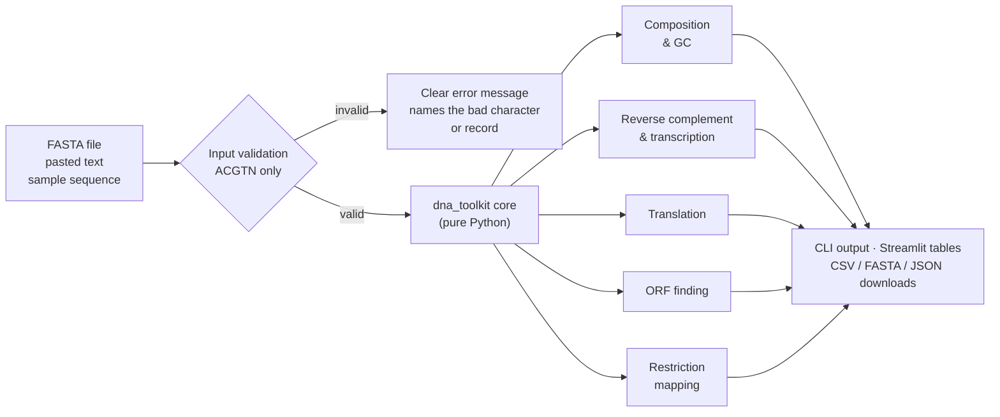

<div align="center">



# DNA Sequence Analysis Toolkit

**A small, dependency-free Python toolkit for common DNA sequence analyses, with a command line and a web interface.**

[](https://github.com/manojkumarmansingh/dna-sequence-toolkit/actions/workflows/tests.yml)
[](LICENSE)
[](https://www.python.org/)
[](app.py)

</div>

---

## Introduction

This project takes a DNA sequence, whether pasted in, uploaded as FASTA, or read
from a file on disk, and answers the questions you would normally reach for a
bioinformatics suite to answer: what is its GC content, what does it translate
to, where are its open reading frames, and which restriction enzymes cut it.

The analysis engine is pure Python: **no NumPy, no Biopython, no third-party
runtime dependencies**. That is a deliberate choice. Reading the code should
teach you how each calculation actually works, rather than showing you a call
into a library that hides the biology.

Three ways to use it, all backed by the same functions:

| Interface | Entry point | Best for |
| --- | --- | --- |
| Python library | `from dna_toolkit import ...` | Scripts, notebooks, pipelines |
| Command line | `python -m dna_toolkit` | Quick checks, shell pipelines |
| Web app | `streamlit run app.py` | Exploring a sequence without writing code |

## Features

| Feature | What it does | Notes |
| --- | --- | --- |
| **Base composition** | Counts and fractions for A, C, G, T and N | Fractions always sum to 1 |
| **GC content** | GC as a percentage | Ambiguous bases excluded from the denominator |
| **Molecular weight** | Approximate single-strand DNA mass in Da | N contributes no mass |
| **Reverse complement** | Standard base pairing, mixed case and N supported | Palindromes map to themselves |
| **Transcription** | DNA → RNA (T → U) | Standard pairing |
| **Translation** | Codon → protein, any reading frame | Standard genetic code (table 1); unknown codons → `X` |
| **ORF finding** | Start codon to first in-frame stop, both strands, all 3 frames | Configurable start codons (e.g. add GTG, TTG) |
| **Restriction mapping** | 12 common enzymes, or your own set | Optional circular-molecule mode |
| **FASTA parsing** | Single or multi-record files | Validates each record and names the one that failed |
| **k-mer counting** | Counts of every k-mer for any k | Any k up to the sequence length |
| **Downloads** | CSV and FASTA export from the web app | Summary available as JSON |

## How it works



## Installation

**Library and command line only:** nothing to install beyond Python 3.9+.

```bash
git clone https://github.com/manojkumarmansingh/dna-sequence-toolkit.git
cd dna-sequence-toolkit
pip install -e .
```

**With the web interface:**

```bash
pip install -r requirements.txt
streamlit run app.py
```

## Web app

```bash
streamlit run app.py
```

Then open the URL Streamlit prints (usually `http://localhost:8501`).

The interface opens with a navy header carrying the version and a status chip
for the loaded sequence, then a monospaced sequence workspace with **Analyse
sequence**, **Load example** and **Clear** buttons. Picking a built-in sample or
uploading a FASTA file loads and analyses it in one click.

Seven sections follow, selected from a horizontal tool bar that wraps on narrow
screens: **Overview**, **Composition**, **Transform**, **Translation**, **ORFs**,
**Restriction sites** and **k-mer analysis**. Overview and every other section
lead with a responsive grid of metric cards (length, GC content, molecular
weight, ORF count) that reflows on mobile, and every result table can be
downloaded as CSV, sequences as FASTA, and the summary as JSON.

Input is validated before any analysis runs, so a stray `X` produces a message
naming the offending character rather than a traceback.

> **Screenshots:** the `docs/screenshots/` folder is where they belong, but none
> are committed yet. Capture them from your own run of the app (see
> [docs/DEPLOYMENT.md](docs/DEPLOYMENT.md#screenshots)) rather than trusting a
> placeholder image.

## Command line

Every command accepts either a sequence (`-s`) or a FASTA file (`-i`), plus
`--record NAME` to pick a record from a multi-record file.

```bash
python -m dna_toolkit stats -i examples/example.fasta --min-orf-aa 1
```

```
Length (bp): 42
GC content (%): 38.1
Molecular weight (Da): 12252.9
Base counts: {'A': 15, 'C': 8, 'G': 8, 'N': 0, 'T': 11}
ORFs (>= 1 aa): 1
Restriction sites: {'EcoRI': [25], 'BamHI': [31], 'HindIII': [18]}
```

<details>
<summary>More commands</summary>

```bash
python -m dna_toolkit gc -s ATGCGCAT
# GC content (%): 50.0

python -m dna_toolkit revcomp -s ATGCGT
# ACGCAT

python -m dna_toolkit translate -s ATGGCTAAACGTACGTTAAGCTTCGAATTCGGATCCAAATAA
# Protein: MAKRTLSFEFGSK

python -m dna_toolkit orfs -i examples/example.fasta --min-aa 1
# 1 ORF(s) of at least 1 aa:
#   strand +  frame 1  1-42  13 aa
#     MAKRTLSFEFGSK*

python -m dna_toolkit digest -s GAATTCGGATCCAAGCTT
# EcoRI    [1]
# BamHI    [7]
# HindIII  [13]

python -m dna_toolkit kmers -s ATAT -k 2
# AT	2
# TA	1
```

</details>

## Python library

```python
from dna_toolkit import gc_content, reverse_complement, translate, find_orfs

seq = "ATGGCTAAACGTACGTTAAGCTTCGAATTCGGATCCAAATAA"

print(gc_content(seq))                     # 38.095238095238095
print(reverse_complement(seq))             # TTATTTGGATCCGAATTCGAAGCTTAACGTACGTTTAGCCAT
print(translate(seq, stop_at_stop=True))   # MAKRTLSFEFGSK

for orf in find_orfs(seq, min_aa=10):
    print(orf["strand"], orf["start"], orf["end"], orf["protein"])
```

### API reference

| Function | Purpose |
| --- | --- |
| `clean_sequence(seq)` | Uppercase and strip whitespace |
| `validate_sequence(seq)` | Reject empty input or characters outside ACGTN |
| `base_composition(seq)` | Counts and fractions per base |
| `gc_content(seq)` | GC content as a percentage |
| `molecular_weight(seq)` | Approximate single-strand DNA mass (Da) |
| `kmer_counts(seq, k)` | Counts of every k-mer |
| `reverse_complement(seq)` | Reverse complement |
| `transcribe(seq)` | DNA → RNA |
| `translate(seq, frame, stop_at_stop)` | Translate to protein |
| `find_orfs(seq, min_aa, start_codons)` | ORFs on both strands |
| `find_restriction_sites(seq, enzymes, circular)` | Restriction-site positions |
| `read_fasta(path)` / `read_fasta_string(text)` | Parse FASTA |
| `summarize(seq, min_orf_aa)` | One-call summary report |

Coordinates are **1-based and inclusive** throughout, and ORFs found on the
minus strand are reported in the coordinates of the sequence you supplied.

## Scientific notes and limitations

These are the honest boundaries of what the toolkit does. They are also
documented in the docstrings of the functions they apply to.

- **Genetic code.** Translation uses the standard code (NCBI table 1) only.
  Mitochondrial and alternative tables are not implemented.
- **Start codons.** ORF finding defaults to `ATG`. Bacterial genes often use
  `GTG` or `TTG`, which you can enable with `start_codons={"ATG", "GTG", "TTG"}`.
  Note that a GTG start still translates to valine under table 1, even though it
  acts as a start codon.
- **ORF definition.** An ORF runs from a start codon to the *first* in-frame
  stop. After a stop is found, scanning resumes past it, so ORFs reported within
  one frame do not overlap. This is a simplification: real annotation considers
  nested and overlapping ORFs, and the toolkit does not.
- **GC content.** Ambiguous bases (N) are excluded from the denominator.
  Counting them as non-GC would understate the GC fraction of the known bases.
- **Molecular weight.** An approximation for single-stranded DNA. Ambiguous
  bases contribute zero mass, so sequences containing N are underestimated.
- **Restriction sites.** Forward strand only. No modelling of DNA methylation,
  star activity, or the cut offset within the recognition site. Circular mode
  detects sites spanning the origin but still reports forward-strand positions.
- **FASTA parsing.** Supports headers, multi-record files, CRLF line endings,
  blank lines and lowercase sequence. It does not parse GenBank, EMBL or FASTQ.
- **Scale.** Everything is pure Python and in-memory. There is no streaming, so
  very large genomes will be slow; this is a teaching and small-analysis tool,
  not a replacement for a production pipeline.

Nothing in this repository has been benchmarked against an established tool.
If you need validated production results, use Biopython, samtools or a
reference pipeline and treat this as the learning implementation it is.

## Project structure

```
dna-sequence-toolkit/
├── app.py                      # Streamlit web interface
├── dna_toolkit/
│   ├── __init__.py             # public API
│   ├── core.py                 # all sequence analysis
│   ├── cli.py                  # command-line interface
│   └── __main__.py             # enables `python -m dna_toolkit`
├── examples/
│   ├── example.fasta
│   └── samples.py              # demo sequences used by the app
├── tests/
│   ├── test_core.py            # core behaviour
│   ├── test_edge_cases.py      # boundaries and tricky biology
│   └── test_app.py             # web interface smoke tests (AppTest)
├── docs/
│   ├── banner.png
│   ├── make_banner.py
│   └── DEPLOYMENT.md
├── .github/workflows/tests.yml
├── .streamlit/config.toml
├── requirements.txt            # web app dependencies
├── requirements-dev.txt        # test dependencies
└── pyproject.toml
```

## Testing

```bash
pip install -r requirements-dev.txt
python -m pytest -q
```

The suite currently holds **75 tests**, covering the core behaviour plus edge
cases: sequences shorter than a codon, all-ambiguous input, palindromes,
reverse-strand ORF coordinates, alternative start codons, restriction sites
spanning the origin of a circular molecule, CRLF FASTA files, and records that
fail validation. CI runs them on Python 3.9, 3.10, 3.11 and 3.12.

`tests/test_app.py` drives the web app itself through Streamlit's `AppTest`
harness: it boots the script, loads and analyses a sequence, opens every section,
and checks the friendly error path, the Clear button and multi-record FASTA
handling. The module skips itself when Streamlit is not installed, so the core
test job stays dependency-free.

## Deployment

The web app is ready for Streamlit Community Cloud. Short version:

1. Push this repository to GitHub (public).
2. Go to [share.streamlit.io](https://share.streamlit.io), sign in with GitHub.
3. **New app** → choose this repository → branch `main` → main file `app.py`.
4. Deploy. Dependencies come from `requirements.txt`.

Full steps, including how to test the build locally and how to capture
screenshots, are in [docs/DEPLOYMENT.md](docs/DEPLOYMENT.md).

> This app is **not** deployed yet. No live URL is claimed here.

## Suggested repository topics

`bioinformatics` · `dna` · `sequence-analysis` · `genomics` · `python` ·
`streamlit` · `cli` · `orf-finding` · `restriction-enzymes` · `teaching`

## Contributing

Issues and pull requests are welcome. If you are changing an analysis function,
please add a test that fails before your change and passes after it. The
`tests/` folder is the best documentation of the intended behaviour.

## License

MIT. See [LICENSE](LICENSE).

## Author

Manoj Kumar Mansingh · [GitHub](https://github.com/manojkumarmansingh)
